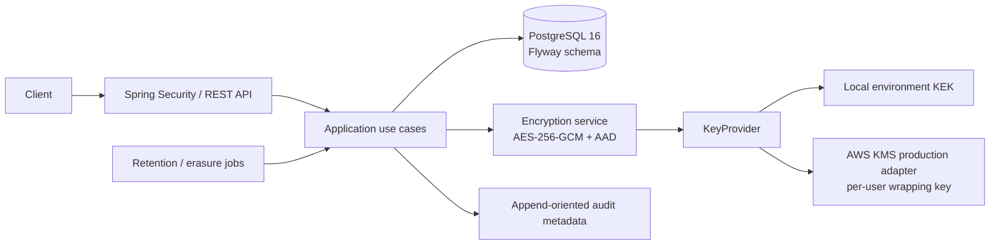

# PrivacyVault

PrivacyVault is a Java 25 / Spring Boot REST backend demonstrating privacy by design for a user's own personal data. It encrypts personal fields at rest, supports user data access/export, rectification, consent history, processing restriction and erasure, and records privacy-safe audit metadata.

This is a portfolio/reference application, not legal advice or a claim of GDPR certification. A controller does not replace a documented lawful basis, a DPIA where required, a processor agreement, or an operational retention policy.

## Start locally (PowerShell, 3 commands)

From the project root:

```powershell
powershell.exe -NoProfile -ExecutionPolicy Bypass -File .\scripts\init-env.ps1
docker compose up --build -d
docker compose ps
```

The initialization script creates high-entropy local secrets and refuses to overwrite an existing `.env`. Keep that file private. Docker Compose starts PostgreSQL 16 and the Java 25 API; the API applies Flyway migrations at startup.

OpenAPI JSON: `http://localhost:8080/v3/api-docs`. Swagger UI is not bundled because its embedded DOMPurify version has known vulnerabilities. Health: `http://localhost:8080/actuator/health`.

## Production deployment preparation

Production settings are separate from the local development Compose stack. See
[docs/PRODUCTION-DEPLOYMENT.md](docs/PRODUCTION-DEPLOYMENT.md) before using
`compose.production.yml`. The production profile requires AWS KMS, explicit
HTTPS CORS origins, mounted secret files, and disabled API documentation. This
repository does not create cloud resources, TLS certificates, backups, or
administrator accounts; completing those operator-owned steps is still
required before processing real personal data.

## Example requests

PowerShell examples use `curl.exe` so the commands invoke curl rather than the legacy PowerShell alias.

```powershell
$register = curl.exe -s -X POST http://localhost:8080/api/v1/auth/register `
  -H "Content-Type: application/json" `
  -d '{"email":"alex@example.test","password":"Portfolio-Password-2026!"}' | ConvertFrom-Json
$access = $register.accessToken
$refresh = $register.refreshToken
```

```powershell
curl.exe -s http://localhost:8080/api/v1/users/me/data `
  -H "Authorization: Bearer $access"
curl.exe -s http://localhost:8080/api/v1/users/me/export `
  -H "Authorization: Bearer $access"
curl.exe -s -X PATCH http://localhost:8080/api/v1/users/me `
  -H "Authorization: Bearer $access" -H "Content-Type: application/json" `
  -d '{"firstName":"Alex","phone":"+49 30 123456"}'
```

Request scheduled erasure and save the one-time cancellation token returned by the API:

```powershell
$erasure = curl.exe -s -X DELETE "http://localhost:8080/api/v1/users/me" `
  -H "Authorization: Bearer $access" -H "Content-Type: application/json" `
  -d '{"password":"Portfolio-Password-2026!"}' | ConvertFrom-Json
```

To cancel before the configured grace period expires:

```powershell
curl.exe -i -X POST http://localhost:8080/api/v1/users/me/erasure/cancel `
  -H "Content-Type: application/json" `
  -d ('{"cancellationToken":"' + $erasure.cancellationToken + '"}')
```

Use `DELETE /api/v1/users/me?immediate=true` to skip the grace period; password confirmation is still required.

## Architecture



Package layout follows `config`, `common`, `security`, `crypto`, `user`, `consent`, `gdpr`, and `audit`. REST DTOs are separate from JPA entities. The schema diagram is in [docs/ER-DIAGRAM.md](docs/ER-DIAGRAM.md).

## Security design

- Every user receives a random 256-bit DEK. Personal values are encrypted with AES-256-GCM, fresh 96-bit IVs and AAD binding user UUID + field name. The stored envelope includes a format and crypto version.
- Email is encrypted and indexed using HMAC-SHA256 over the normalized email with a dedicated blind-index secret. Consent, IP, audit, and erasure pseudonyms use a separate HMAC secret with purpose-specific domain separation. Passwords use Argon2id.
- Local development uses a 32-byte environment KEK. Production can select `KEY_PROVIDER=aws-kms`; this adapter creates a distinct AWS KMS key for each user to wrap their DEK. KMS key deletion is scheduled with AWS's minimum seven-day waiting period, but the key is disabled immediately, denying decryption. See [docs/SECURITY.md](docs/SECURITY.md) for credentials, quotas, rotation and recovery caveats.
- Managed KMS rotation is controlled by `AWS_KMS_ROTATION_EPOCH`; increment the configured epoch (for example `v1` to `v2`) before invoking the admin rotation endpoint. Already re-wrapped DEKs on the active epoch are skipped, so repeating the operation is safe.
- Access JWTs last 15 minutes. Refresh tokens last 7 days, are stored as SHA-256 hashes, rotate on use, and a detected reuse revokes the token family. Access tokens check account status and a persistent token version.
- API login errors are generic; an in-memory Bucket4j rate limiter and a five-failure, 15-minute account lockout protect authentication. Use a shared Bucket4j backend before running multiple API replicas.
- Audit rows contain pseudonymous references and event metadata only—not emails, profile values, passwords, keys, tokens or request bodies. Keep access to audit storage restricted.
- HTTPS is assumed at the reverse proxy/load balancer. Compose is for local development; configure TLS termination, trusted proxy headers and a managed secret store before deployment.

## API overview

| Method and route | Purpose |
|---|---|
| `POST /api/v1/auth/register` | Create account and issue tokens |
| `POST /api/v1/auth/login` | Login |
| `POST /api/v1/auth/refresh` | Rotate refresh token |
| `POST /api/v1/auth/logout` | Revoke a refresh token |
| `POST /api/v1/auth/logout-all` | Revoke refresh tokens and invalidate access tokens |
| `GET /api/v1/users/me/data` | Decrypted personal-data access |
| `GET /api/v1/users/me/export` | JSON portability export |
| `PATCH /api/v1/users/me` | Rectify profile fields |
| `GET, POST /api/v1/users/me/consents` | Query and append consent events |
| `PATCH /api/v1/users/me/restriction` | Set or lift processing restriction |
| `DELETE /api/v1/users/me` | Request erasure; `?immediate=true` skips grace |
| `POST /api/v1/users/me/erasure/cancel` | Cancel with the one-time cancellation token |
| `GET /api/v1/admin/audit` | Admin-only audit metadata |
| `POST /api/v1/admin/keys/rotate` | Admin-only DEK re-wrapping via KMS |

The full OpenAPI description is published at `/v3/api-docs`. Swagger UI is not bundled because its embedded DOMPurify version has known vulnerabilities. A checked-in specification is [docs/openapi.yaml](docs/openapi.yaml).

## Verify

Requirements: JDK 25, Maven 3.9+, Docker Desktop with its Linux engine running.

```powershell
mvn -B verify
mvn -B org.owasp:dependency-check-maven:check
```

Integration tests use Testcontainers and need a running Docker engine. GitHub Actions runs tests and Dependency-Check. Set an `NVD_API_KEY` in CI to avoid slow/limited vulnerability database updates.

## Documentation

- [GDPR article mapping](docs/GDPR-COMPLIANCE.md)
- [Threat model, TOMs and incident response](docs/SECURITY.md)
- [Processing activities register template (German)](docs/PROCESSING-ACTIVITIES.md)
- [ER diagram](docs/ER-DIAGRAM.md)
- [Project presentations (English, German and Uzbek)](docs/presentation/README.md)

## License

This project is distributed under the [MIT License](LICENSE).

## Known limitations and future improvements

- The local shared KEK cannot guarantee erasure from old database backups. Use the KMS adapter for that stronger property; its per-user keys incur cost and account-quota overhead. AWS's scheduled deletion window means irreversible key destruction is delayed even though access is disabled at request time.
- The example AWS adapter creates one customer-managed KMS key per user. A production system with a large population should evaluate a scalable HSM/KMS design with independently destroyable per-subject key material, hard quotas, account limits, alarms and restore drills before use.
- The local environment key provider does not rotate the KEK through the admin endpoint. Replace the configured secret only with a controlled migration/rewrap procedure and backup plan.
- Defaults are 14 days for scheduled erasure, 365 days for audit and erasure-proof records, 1095 days for consent events, and 730 days before an account is marked inactive. Inactive accounts have tokens revoked; a valid login reactivates them. These sample values are configurable and must be aligned with a reviewed retention policy.
- Rate limiting is process-local. Use a shared distributed backend, API gateway throttling and account-aware abuse controls for multiple replicas.
- Admin assignment is intentionally not exposed over the public API. Provision and review administrator roles through a protected operational process; the project does not include a production identity provider, MFA, email verification, password reset or account-notification delivery.
- Consent and erasure proof use keyed pseudonymous references. Pseudonymized data may still be personal data; retention, key custody and legal bases require controller review.
- The sample does not implement CSV, external KMS integration tests, database-level audit immutability, email delivery, a full outbox for KMS/DB distributed transactions, or legal basis enforcement. Add these before any real-person production use.
